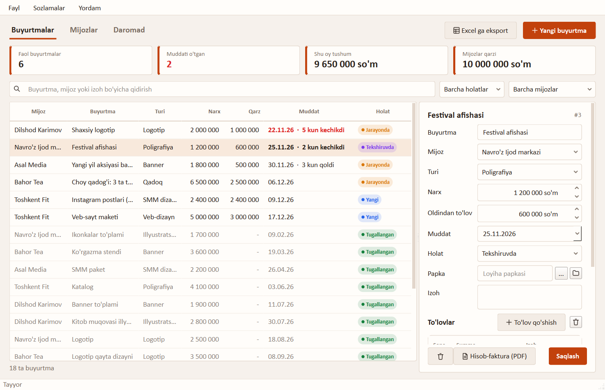
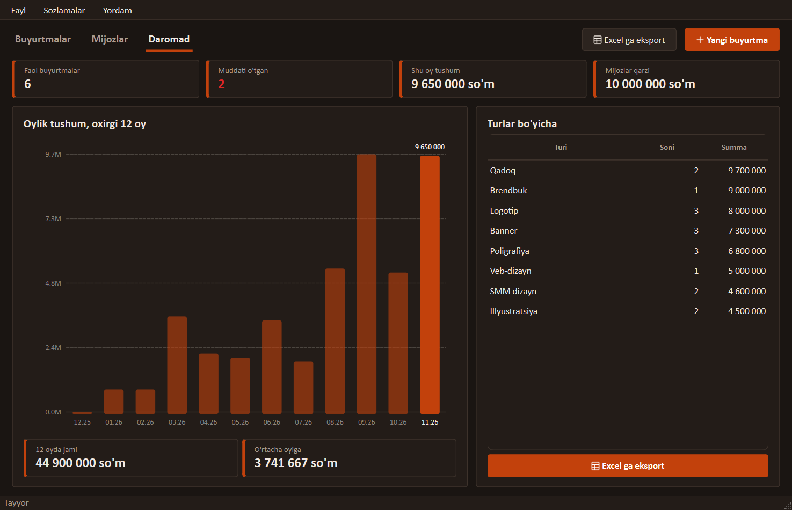
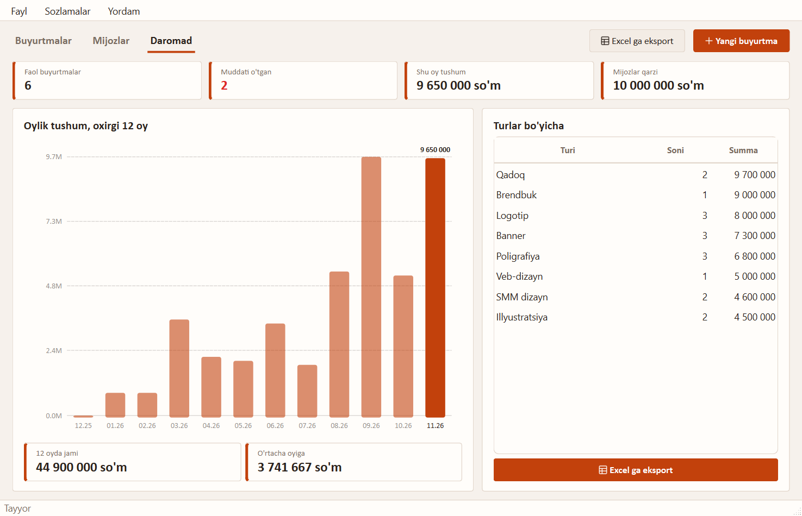

<h1 align="center">Mijoz buyurtmalari daftari</h1>

<b>Client Orders Journal</b> · Журнал заказов клиентов

   
  
  
  
  

Frilanser dizayner uchun buyurtmalar daftari: mijozlar, buyurtmalar, oldindan to'lov va to'lovlar, muddatlar, qarzlar va oylik daromad. Excel eksport va PDF hisob-faktura.

## Imkoniyatlar

- Mijozlar: ism, telefon, Telegram, izoh va har birining buyurtmalari
- Buyurtmalar: tur, narx (so'm), oldindan to'lov, muddat, holat, loyiha papkasi
- Holatlar: yangi, jarayonda, tekshiruvda, tugallangan, bekor; rangli belgilar
- Muddati o'tgan buyurtmalar qizil bilan ajratiladi
- Ko'rsatkichlar: faol buyurtmalar, muddati o'tganlar, shu oy tushum, mijozlar qarzi
- Oxirgi 12 oy daromad grafigi va turlar bo'yicha hisobot
- Excel ga eksport, PDF hisob-faktura (dizayner ismi bilan)
- Ma'lumotlar kompyuterda, SQLite bazada; internet kerak emas

## O'rnatish

1. [**BuyurtmalarDaftari.exe**](https://github.com/eduhakimov/buyurtmalar-daftari/releases/latest/download/BuyurtmalarDaftari.exe) faylini yuklab oling.
2. Faylni ishga tushiring, o'rnatish shart emas.
3. Windows SmartScreen ogohlantirsa: **Batafsil → Baribir ishga tushirish**.

**Tizim talablari:** Windows 10 (1809+) / Windows 11, x64

## Hujjatlar

- [Ilmiy maqola](docs/materiallar/ILMIY-MAQOLA.md)
- [Foydalanish qo‘llanmasi](docs/materiallar/FOYDALANISH-QOLLANMASI.md)
- [Uslubiy ko‘rsatma](docs/materiallar/USLUBIY-KORSATMA.md)

Word formatida: [foydalanish qo‘llanmasi](docs/materiallar/Mijoz%20buyurtmalari%20daftari%20-%20foydalanish%20qo‘llanmasi.docx) · [ilmiy maqola](docs/materiallar/Mijoz%20buyurtmalari%20daftari%20-%20ilmiy%20maqola.docx) · [uslubiy ko‘rsatma](docs/materiallar/Mijoz%20buyurtmalari%20daftari%20-%20uslubiy%20ko‘rsatma.docx)

---

## Русский

Журнал заказов для дизайнера-фрилансера: клиенты, заказы, предоплата и платежи, сроки, долги и доход по месяцам. Экспорт в Excel и счета в PDF.

- Клиенты: имя, телефон, Telegram, заметки и их заказы
- Заказы: тип, цена (сум), предоплата, срок, статус, папка проекта
- Статусы: новый, в работе, на проверке, завершён, отменён; цветные метки
- Просроченные заказы выделяются красным
- Показатели: активные заказы, просроченные, поступления за месяц, долг клиентов
- График дохода за 12 месяцев и отчёт по типам работ
- Экспорт в Excel, счёт в PDF (с именем дизайнера)
- Данные хранятся локально в SQLite; интернет не нужен

## English

An order journal for freelance designers: clients, orders, prepayments and payments, deadlines, balances and monthly income. Excel export and PDF invoices.

- Clients: name, phone, Telegram, notes and their orders
- Orders: type, price (UZS), prepayment, deadline, status, project folder
- Statuses: new, in progress, in review, completed, cancelled with colour tags
- Overdue orders highlighted in red
- Overview: active orders, overdue, received this month, outstanding balance
- 12-month income chart and breakdown by work type
- Excel export and PDF invoices with the designer's name
- Data stays on your computer in SQLite; no internet needed

---

## Muallif / Author

**Bahtiyorjon Hakimov** (Hakimov Bahtiyorjon Muzaffar o'g'li), [github.com/eduhakimov](https://github.com/eduhakimov)

© 2026 Bahtiyorjon Hakimov. Barcha huquqlar himoyalangan. / Все права защищены. / All rights reserved.
Batafsil: [LICENSE](LICENSE) · Uchinchi tomon komponentlari: [THIRD_PARTY_NOTICES.md](THIRD_PARTY_NOTICES.md)
