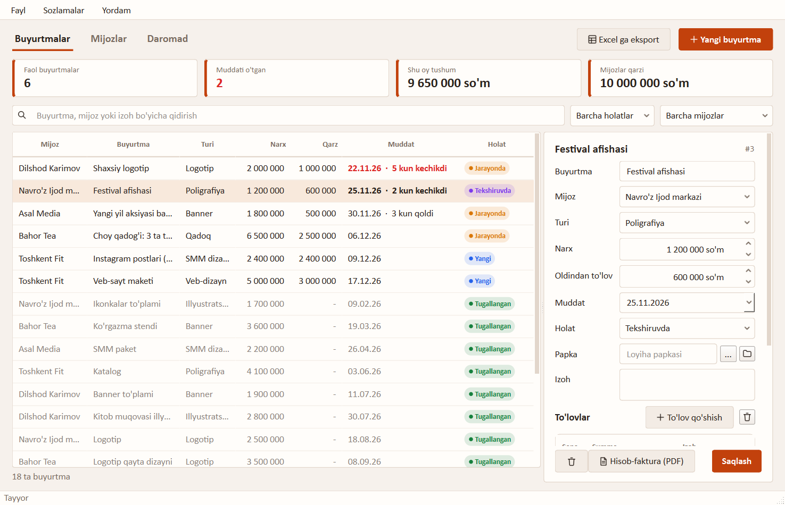
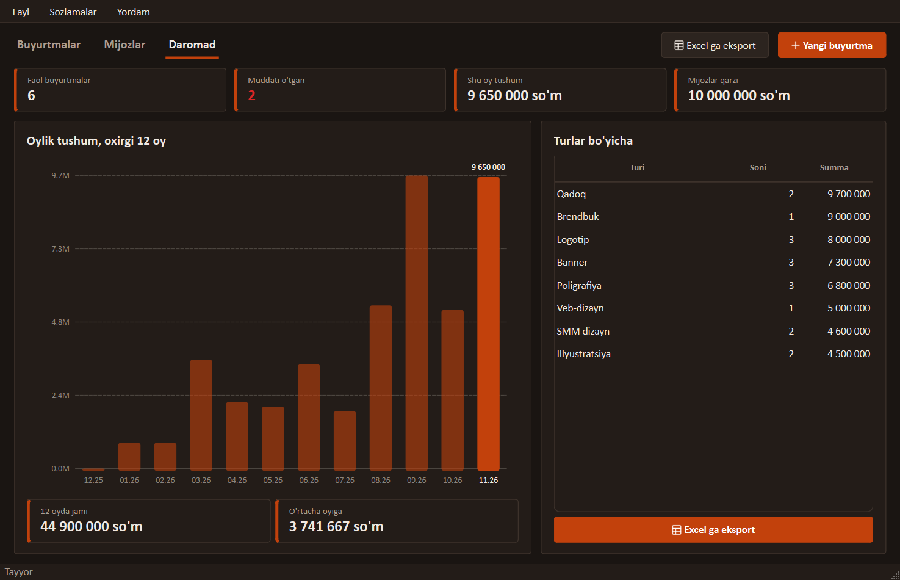
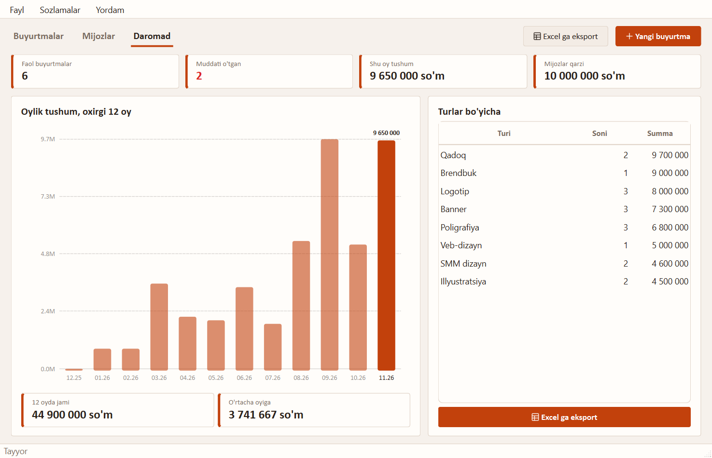

# Mijoz buyurtmalari daftari: Foydalanish qo‘llanmasi

Muallif: Hakimov Bahtiyorjon. Versiya: 1.0.2.

## 1. Umumiy ma’lumot

“Mijoz buyurtmalari daftari” mustaqil ishlovchi dizayner yoki kichik ijodiy studiya uchun buyurtmalarni hisobga olish dasturi. U mijozlar ro‘yxatini, har bir buyurtmaning narxi, oldindan to‘lovi, muddati va holatini, keyingi to‘lovlarni yuritadi, qarz va muddati o‘tgan buyurtmalarni avtomatik ko‘rsatadi, oylik daromadni grafikda aks ettiradi.

Dastur yordamida quyidagi vazifalar bajariladi:

- mijozlar kartotekasini (ism, telefon, Telegram, izoh) yuritish;
- buyurtmalarni ish turi, narx, muddat va holat bo‘yicha qayd etish, loyiha papkasini biriktirish;
- oldindan to‘lov va keyingi to‘lovlarni kiritish, qarzni avtomatik hisoblash;
- muddati o‘tgan buyurtmalarni ajratib ko‘rish;
- oxirgi 12 oylik tushum va ish turlari bo‘yicha hisobotni ko‘rish;
- ma’lumotlarni Excel fayliga eksport qilish va mijozga PDF hisob-faktura tayyorlash.
Dastur interfeysi o‘zbek, rus va ingliz tillarida, yorug‘ va qorong‘i mavzularda ishlaydi. Summalar so‘mda yuritiladi. Qo‘llanmada tugma va bo‘lim nomlari dasturning o‘zbekcha interfeysidagidek berilgan.

Dastur ayniqsa bir vaqtning o‘zida bir nechta mijoz bilan ishlaydigan va to‘lovlarni bo‘lib-bo‘lib oladigan mutaxassislar uchun qulay: har bir to‘lov buyurtmaga bog‘lanib, sanasi bilan saqlanadi, shuning uchun istalgan paytda kim qancha qarzi borligini ko‘rish mumkin.

## 2. Tizim talablari

- Operatsion tizim: Windows 10 (1809 va undan keyingi versiyalar) yoki Windows 11, 64 bitli.
- Internet aloqasi talab qilinmaydi. Faqat mijoz kartasidagi “Telegram” tugmasi Telegram sahifasini brauzerda ochish uchun internetdan foydalanadi.
- O‘rnatish shart emas: dastur bitta bajariladigan fayldan iborat.
- Excel faylini ko‘rish uchun xlsx formatini ochadigan dastur, PDF hisob-fakturani ko‘rish uchun PDF ko‘ruvchi kerak bo‘ladi.
Dastur ishlashi uchun qo‘shimcha dasturlar, ma’lumotlar bazasi serveri yoki internet orqali ro‘yxatdan o‘tish talab etilmaydi: barcha zarur komponentlar bajariladigan fayl ichida joylashgan.

## 3. O‘rnatish va ishga tushirish

1. Dasturning GitHub sahifasidagi (https://github.com/eduhakimov/buyurtmalar-daftari) Releases bo‘limidan bajariladigan faylni yuklab oling.
2. Faylni qulay papkaga joylashtiring va ikki marta bosib ishga tushiring.
3. Birinchi ishga tushirishda Windows SmartScreen “Windows kompyuteringizni himoya qildi” degan ogohlantirish chiqarishi mumkin. Bu imzolanmagan dasturlar uchun odatiy holat: “Batafsil” havolasini, so‘ng “Baribir ishga tushirish” tugmasini bosing.
4. Dastur birinchi marta ochilganda bo‘sh baza yaratiladi va buyurtmalar ro‘yxatida “Buyurtmalar yo‘q. “Yangi buyurtma” tugmasini bosing.” degan yozuv chiqadi.
Dasturni yangilash uchun yangi versiyani yuklab olib, eski faylni almashtiring. Ma’lumotlar bazasi foydalanuvchi profilida saqlangani sababli yangilashda ma’lumotlar yo‘qolmaydi.

Dasturni kompyuterdan o‘chirish uchun bajariladigan faylni o‘chirish kifoya. Ma’lumotlar bazasi bunda o‘chirilmaydi; agar ma’lumotlar ham kerak bo‘lmasa, %APPDATA%\BahtiyorSoft\buyurtmalar-daftari papkasini qo‘lda o‘chiring. Buni qilishdan oldin baza faylidan zaxira nusxa olishni unutmang.

## 4. Dastur oynasi bilan tanishish

Oynaning yuqori qismida menyu satri (“Fayl”, “Sozlamalar”, “Yordam”) joylashgan. Uning ostida uchta yorliq bor: “Buyurtmalar”, “Mijozlar” va “Daromad”. O‘ng tomonda “Excel ga eksport” va “Yangi buyurtma” tugmalari joylashgan.

Yorliqlar ostida to‘rtta ko‘rsatkich kartasi har doim ko‘rinadi:

- “Faol buyurtmalar” – “Yangi”, “Jarayonda” va “Tekshiruvda” holatidagi buyurtmalar soni;
- “Muddati o‘tgan” – muddati o‘tgan faol buyurtmalar soni; kartani bosish ro‘yxatda faqat ularni qoldiradi;
- “Shu oy tushum” – joriy oyda tushgan oldindan to‘lov va to‘lovlar yig‘indisi;
- “Mijozlar qarzi” – barcha bekor qilinmagan buyurtmalar bo‘yicha to‘lanmagan qoldiq.
“Buyurtmalar” ko‘rinishida chapda qidiruv maydoni, holat va mijoz filtrlari hamda buyurtmalar jadvali, o‘ngda tanlangan buyurtmani tahrirlash paneli joylashgan. Jadval ostida buyurtmalar soni ko‘rsatiladi. Pastdagi holat satrida saqlash natijalari haqida xabarlar chiqadi.

“Mijozlar” ko‘rinishida chapda qidiruv maydoni va mijozlar jadvali (“Nomi”, “Telefon”, “Telegram”, “Buyurtmalar”, “Jami”, “Qarz”), o‘ngda mijoz kartasi joylashgan. Kartada “Nomi”, “Telefon”, “Telegram”, “Izoh” maydonlari, Telegram sahifasini ochuvchi tugma, “Mijoz buyurtmalari” jadvali hamda o‘chirish, “Yangi buyurtma” va “Saqlash” tugmalari bor.

“Daromad” ko‘rinishida chapda “Oylik tushum, oxirgi 12 oy” grafigi va uning ostidagi ikki ko‘rsatkich, o‘ngda “Turlar bo‘yicha” jadvali va “Excel ga eksport” tugmasi joylashgan. Grafik ustunlari ustiga sichqoncha olib borilganda tegishli oy summasi ko‘rsatiladi.

*1-rasm. “Buyurtmalar” ko‘rinishi: ko‘rsatkich kartalari, filtrlar, buyurtmalar jadvali va o‘ngda “Festival afishasi” buyurtmasi paneli*

*2-rasm. “Mijozlar” ko‘rinishi (qorong‘i mavzu): mijozlar jadvali va tanlangan mijoz kartasi*

*3-rasm. “Daromad” ko‘rinishi: oylik tushum grafigi va “Turlar bo‘yicha” jadvali*

## 5. Asosiy amallar

**Mijoz qo‘shish**

1. “Mijozlar” yorlig‘iga o‘ting.
2. O‘ng kartadagi “Yangi mijoz” tugmasini bosing.
3. “Nomi”, “Telefon”, “Telegram” va “Izoh” maydonlarini to‘ldiring. Telegram manzilini “@nom”, “nom” yoki “t.me/nom” ko‘rinishida kiritish mumkin, dastur uni “@nom” shakliga keltiradi.
4. “Saqlash” tugmasini bosing. Ism kiritilmasa, “Mijoz ismini kiriting.” xabari chiqadi.
**Buyurtma qo‘shish**

1. Yuqoridagi “Yangi buyurtma” tugmasini bosing yoki mijoz kartasidagi “Yangi buyurtma” tugmasidan foydalaning (bunda mijoz avtomatik tanlanadi).
2. O‘ng panelda “Buyurtma” (nomi), “Mijoz”, “Turi”, “Narx”, “Oldindan to‘lov”, “Muddat” va “Holat” maydonlarini to‘ldiring.
3. Kerak bo‘lsa, “Papka” maydoni yonidagi “...” tugmasi bilan loyiha papkasini tanlang va “Izoh” yozing.
4. “Saqlash” tugmasini bosing. Buyurtma nomi kiritilmasa, “Buyurtma nomini kiriting.” xabari chiqadi.
**To‘lov kiritish**

1. Jadvaldan buyurtmani tanlang.
2. “To‘lovlar” bo‘limidagi “To‘lov qo‘shish” tugmasini bosing.
3. “To‘lov summasi (so‘m):” oynasida standart qiymat sifatida buyurtmaning qolgan qarzi taklif etiladi; kerakli summani kiriting va tasdiqlang. To‘lov bugungi sana bilan qo‘shiladi.
4. Panel pastidagi xulosa va jadvaldagi “Qarz” ustuni avtomatik yangilanadi. Noto‘g‘ri kiritilgan to‘lovni tanlab, o‘chirish tugmasi bilan olib tashlang.
**Holatni o‘zgartirish va muddatni kuzatish**

1. Buyurtmani tanlab, “Holat” ro‘yxatidan “Yangi”, “Jarayonda”, “Tekshiruvda”, “Tugallangan” yoki “Bekor qilingan” ni tanlang va saqlang.
2. “Tugallangan” holatiga o‘tkazilganda tugallangan sana avtomatik yoziladi.
3. Muddati o‘tgan faol buyurtmalar jadvalda qizil rangda, “... kun kechikdi” izohi bilan ko‘rsatiladi. Ularni alohida ko‘rish uchun “Muddati o‘tgan” kartasini bosing yoki holat filtridan “Muddati o‘tgan” ni tanlang.
**Qidirish va filtrlash**

1. “Buyurtma, mijoz yoki izoh bo‘yicha qidirish” maydoniga so‘z kiriting.
2. Holat filtridan “Barcha holatlar”, “Faqat faol”, “Muddati o‘tgan” yoki aniq holatni tanlang.
3. Mijoz filtridan “Barcha mijozlar” yoki aniq mijozni tanlang. Mijozi ko‘rsatilmagan buyurtmalar jadvalning “Mijoz” ustunida “(mijozsiz)” deb ko‘rsatiladi.
**Loyiha papkasini ochish**

Buyurtma panelidagi “Papka” qatoridagi papka belgili tugmani bosing. Papka mavjud bo‘lmasa, “Papka topilmadi” xabari chiqadi.

**Hisob-faktura tayyorlash**

1. Buyurtmani tanlang va “Hisob-faktura (PDF)” tugmasini bosing.
2. Fayl nomi va papkani tasdiqlang. Hujjat yaratilgach, avtomatik ochiladi.
3. Hisob-fakturada dizayner ismi, mijoz, buyurtma ma’lumotlari, to‘lovlar va “To‘lanishi kerak” qoldiq summa ko‘rsatiladi.
**Excel ga eksport**

1. “Excel ga eksport” tugmasini bosing yoki “Fayl” menyusidagi shu bandni tanlang.
2. Fayl nomini tasdiqlang (standart nom buyurtmalar va bugungi sanadan iborat).
3. Faylda buyurtmalar, mijozlar, to‘lovlar va oylik tushum varaqlari bo‘ladi.
**Daromadni ko‘rish**

“Daromad” yorlig‘ida oxirgi 12 oyning tushumi ustunli grafikda ko‘rsatiladi, grafik ostida “12 oyda jami” va “O‘rtacha oyiga” qiymatlari chiqadi. “Turlar bo‘yicha” jadvalida har bir ish turi bo‘yicha buyurtmalar soni va narxlar yig‘indisi ko‘rsatiladi.

**O‘chirish**

Buyurtmani o‘chirish uchun panel pastidagi savat belgili tugmani bosing va so‘rovni tasdiqlang: buyurtma uning to‘lovlari bilan birga o‘chiriladi. Mijoz o‘chirilganda esa uning buyurtmalari saqlanadi, lekin mijozsiz qoladi.

**Namunaviy ish tartibi**

Kundalik ishda quyidagi tartib qulay: yangi murojaat kelganda avval mijozni qo‘shing (agar u bazada bo‘lmasa), so‘ng mijoz kartasidan buyurtma yarating va oldindan to‘lovni kiriting; ish boshlanganda holatni “Jarayonda”, mijozga ko‘rsatish uchun yuborganda “Tekshiruvda” qilib qo‘ying; har bir keyingi to‘lovni tushgan kuni kiriting; ish topshirilgach holatni “Tugallangan” ga o‘zgartiring. Har kuni ish boshida “Muddati o‘tgan” va “Mijozlar qarzi” kartalariga qarab chiqish muddat va qarz nazoratini osonlashtiradi. Oy oxirida “Daromad” ko‘rinishini ko‘rib, kerak bo‘lsa Excel ga eksport qiling.

## 6. Sozlamalar

- **Til:** “Sozlamalar” → “Til” menyusidan O‘zbekcha, Русский yoki English ni tanlang. Tilni almashtirish uchun dastur qayta ishga tushiriladi.
- **Mavzu:** “Sozlamalar” → “Mavzu” menyusidan “Yorug‘”, “Qorong‘i” yoki “Tizim bo‘yicha” ni tanlang.
- **Dizayner ismi:** “Sozlamalar” → “Dizayner ismi...” bandida hisob-fakturada ko‘rsatiladigan ismni kiriting. Ism kiritilmagan bo‘lsa, standart muallif ismi ishlatiladi.
- Qo‘llanma va dastur haqidagi ma’lumot “Yordam” menyusida joylashgan.
Dasturda alohida sozlamalar oynasi yo‘q: til, mavzu va dizayner ismi menyu orqali o‘zgartiriladi, qolgan barcha ma’lumotlar bevosita ko‘rinishlarda kiritiladi. O‘zgartirilgan sozlamalar avtomatik saqlanadi va keyingi ishga tushirishda tiklanadi.

## 7. Ma’lumotlarni saqlash va xavfsizlik

- Barcha ma’lumotlar %APPDATA%\BahtiyorSoft\buyurtmalar-daftari papkasidagi “buyurtmalar.db” faylida saqlanadi. Zaxira nusxa olish uchun dasturni yopib, shu faylni boshqa diskka yoki xotira qurilmasiga nusxalang.
- Ma’lumotlar internetga yuborilmaydi. Mijozlarning telefon raqami va boshqa shaxsiy ma’lumotlari faqat sizning kompyuteringizda saqlanadi, shuning uchun kompyuterga parol qo‘yish tavsiya etiladi.
- Baza fayli buzilgan bo‘lsa, dastur uni sana va vaqt qo‘shilgan nom bilan saqlab qo‘yadi, yangi bo‘sh baza ochadi va zaxira fayl joylashgan yo‘lni ko‘rsatadi. Bu holda buzilgan faylni o‘zgartirmang va mutaxassisga murojaat qiling.
- Dastur loyiha papkalaringizdagi fayllarni o‘zgartirmaydi: “Papka” maydoni faqat papka yo‘lini eslab qoladi va uni Explorer’da ochadi.
- Sozlamalar va xatolar jurnali ham shu papkada saqlanadi.

## 8. Ko‘p uchraydigan savollar va muammolar

**Summa noto‘g‘ri o‘qildi.** Summani bo‘shliqsiz yoki “1 500 000” ko‘rinishida kiriting. Dastur nuqta va vergul bilan ajratilgan minglik guruhlarni ham taniydi, lekin bitta ajratgichdan keyin uchtadan ko‘p yoki kam raqam bo‘lsa, u kasr qism deb tushunilishi mumkin.

**“Faylni saqlab bo‘lmadi” xabari chiqdi.** Fayl boshqa dasturda (masalan, Excel’da) ochiq yoki papka faqat o‘qish uchun bo‘lishi mumkin. Faylni yoping yoki boshqa papkani tanlang.

**Bekor qilingan buyurtmaning qarzi ko‘rinmayapti.** Bekor qilingan buyurtmalar uchun qarz hisoblanmaydi va ularning to‘lovlari tushumga qo‘shilmaydi.

**Buyurtma muddati o‘tgan bo‘lsa ham qizil emas.** Faqat faol holatdagi (“Yangi”, “Jarayonda”, “Tekshiruvda”) buyurtmalar muddati o‘tgan deb belgilanadi. Tugallangan buyurtmalar ajratilmaydi.

**Oldindan to‘lov qaysi oyga yoziladi?** Oldindan to‘lov buyurtma qabul qilingan sana oyiga, keyingi to‘lovlar esa kiritilgan sana oyiga yoziladi.

**Mijozni o‘chirsam, buyurtmalar yo‘qoladimi?** Yo‘q, buyurtmalar saqlanadi va jadvalning “Mijoz” ustunida “(mijozsiz)” deb ko‘rsatiladi. Ularni keyinroq boshqa mijozga biriktirish mumkin.

**SmartScreen dasturni ishga tushirishga ruxsat bermayapti.** “Batafsil” havolasini, so‘ng “Baribir ishga tushirish” tugmasini bosing. Faylni faqat rasmiy GitHub sahifasidan yuklab oling.

**Excel faylida ba’zi qatorlar rangli.** Buyurtmalar varag‘ida muddati o‘tgan buyurtmalar alohida rang bilan ajratiladi, birinchi qator (sarlavhalar) esa aylantirishda qotirilgan holda turadi.

**Ma’lumotlarni boshqa kompyuterga ko‘chirish mumkinmi?** Ha. Ikkala kompyuterda dasturni yoping, “buyurtmalar.db” faylini eski kompyuterdagi %APPDATA%\BahtiyorSoft\buyurtmalar-daftari papkasidan yangisidagi xuddi shu papkaga nusxalang.

**Dastur kutilmagan xato haqida xabar berdi.** Xato tafsilotlari dastur ma’lumotlari papkasidagi jurnal fayliga yoziladi. Muammo takrorlansa, shu faylni GitHub sahifasi orqali muallifga yuboring.

