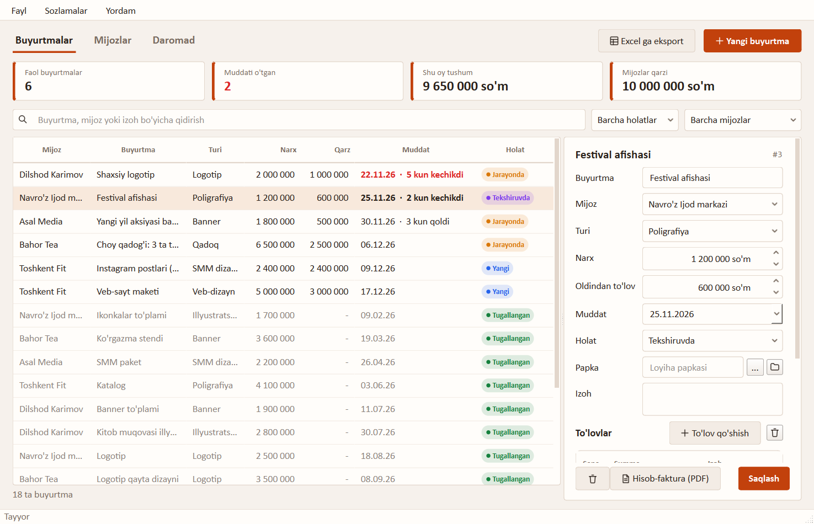
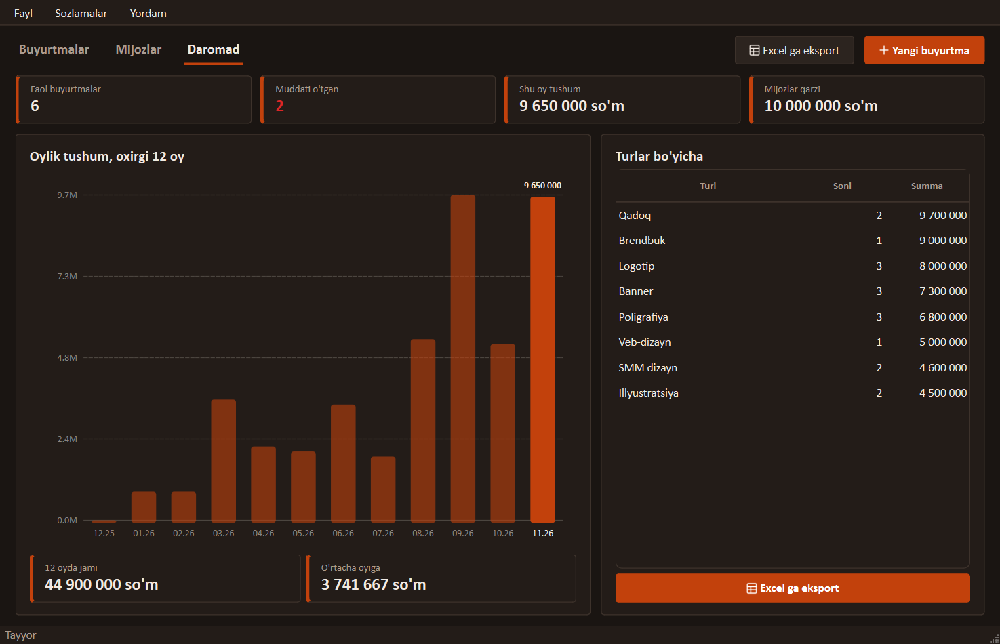
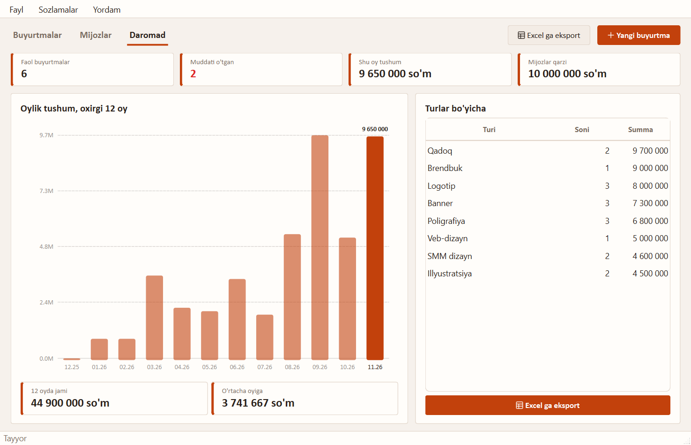

UDK: 004.42:004.65

# Frilanser dizaynerlar uchun mijozlar, buyurtmalar va to‘lovlarni hisobga oluvchi oflayn axborot tizimi: ma’lumotlar modeli, arxitektura va amalga oshirish

**Hakimov Bahtiyorjon**  
*[ish joyi, lavozimi, elektron pochta]*

**Annotatsiya.** Maqolada mustaqil ishlovchi dizaynerlar uchun mo‘ljallangan “Mijoz buyurtmalari daftari” stol dasturi tavsiflanadi. Dastur mijozlar, buyurtmalar va to‘lovlarni o‘zaro bog‘langan uchta jadvaldan iborat SQLite bazasida saqlaydi, har bir buyurtma bo‘yicha to‘langan summa va qarzni avtomatik hisoblaydi, muddati o‘tgan faol buyurtmalarni ajratib ko‘rsatadi, oxirgi 12 oy tushumini grafikda va ish turlari bo‘yicha jadvalda aks ettiradi. Ma’lumotlarni Excel fayliga eksport qilish va PDF hisob-faktura tayyorlash imkoniyatlari mavjud. Dastur Python 3.12 va PySide6 (Qt 6) asosida yaratilgan, internetsiz ishlaydi, interfeysi o‘zbek, rus va ingliz tillarida. Ishda ma’lumotlar modeli, hisob-kitob qoidalari, arxitektura, testlar tarkibi va cheklovlar yoritilgan.

*Kalit so‘zlar:* buyurtmalar hisobi, mijozlar bazasi, frilans, SQLite, hisob-faktura, PySide6, oflayn dastur.

**Офлайн-информационная система учёта клиентов, заказов и оплат для дизайнеров-фрилансеров: модель данных, архитектура и реализация**

**Аннотация.** В статье описывается настольная программа «Mijoz buyurtmalari daftari», предназначенная для дизайнеров, работающих самостоятельно. Программа хранит клиентов, заказы и оплаты в базе SQLite из трёх связанных таблиц, автоматически рассчитывает оплаченную сумму и долг по каждому заказу, выделяет просроченные активные заказы, отображает поступления за последние 12 месяцев на диаграмме и в таблице по видам работ. Предусмотрены экспорт данных в файл Excel и формирование счёта в формате PDF. Программа создана на Python 3.12 и PySide6 (Qt 6), работает без интернета, интерфейс доступен на узбекском, русском и английском языках. Рассмотрены модель данных, правила расчётов, архитектура, состав тестов и ограничения.

*Ключевые слова:* учёт заказов, база клиентов, фриланс, SQLite, счёт, PySide6, офлайн-программа.

**An Offline Information System for Tracking Clients, Orders and Payments of Freelance Designers: Data Model, Architecture and Implementation**

**Abstract.** The paper describes “Mijoz buyurtmalari daftari”, a desktop program for designers who work independently. The program stores clients, orders and payments in an SQLite database of three related tables, automatically calculates the amount paid and the outstanding debt for each order, highlights overdue active orders, and shows income for the last 12 months as a bar chart and a table by type of work. Data can be exported to an Excel workbook, and a PDF invoice can be produced for any order. The program is built with Python 3.12 and PySide6 (Qt 6), works without an internet connection and offers an Uzbek, Russian and English interface. The data model, calculation rules, architecture, test suite and limitations are discussed.

*Keywords:* order tracking, client database, freelancing, SQLite, invoice, PySide6, offline software.

## Kirish

Grafik dizayn sohasida xizmat ko‘rsatuvchi mutaxassislarning katta qismi mustaqil, ya’ni frilans asosida ishlaydi. Bunday mutaxassis bir vaqtning o‘zida bir nechta mijoz bilan ishlaydi, har bir buyurtma bo‘yicha narx, oldindan to‘lov, topshirish muddati va qisman to‘lovlarni kuzatib borishi kerak. Ma’lumotlar yozuv daftarida, messenjer yozishmalarida yoki tartibsiz elektron jadvallarda saqlansa, muddatni o‘tkazib yuborish, qarzdorlikni unutish va oylik daromadni aniq bilmaslik xavfi yuzaga keladi.

“Raqamli O‘zbekiston – 2030” strategiyasida tadbirkorlik va xizmat ko‘rsatish sohasida raqamli texnologiyalarni keng joriy etish vazifasi belgilangan. Mustaqil ishlovchi mutaxassislar va kichik ijodiy jamoalar uchun buyurtmalarni hisobga olishning raqamli vositasi ushbu vazifaning amaliy ko‘rinishlaridan biridir. Bunday vosita mahalliy pul birligida (so‘mda) hisob yuritishi, o‘zbek tilida interfeysga ega bo‘lishi va internet aloqasiga bog‘liq bo‘lmasligi maqsadga muvofiq.

Mazkur maqolada ana shu talablarga javob beruvchi “Mijoz buyurtmalari daftari” dasturi taqdim etiladi. Dastur frilanser dizayner faoliyatining asosiy hisob obyektlarini (mijoz, buyurtma, to‘lov) relyatsion ma’lumotlar bazasida saqlaydi, ular asosida hisob-kitoblarni avtomatik bajaradi va natijalarni ko‘rsatkichlar, grafik hamda hujjatlar ko‘rinishida taqdim etadi.

Buyurtmalar hisobini yuritishning amaliy ahamiyati shundaki, frilanser uchun daromadning asosiy qismi qisman to‘lovlar orqali, turli vaqtda tushadi. Bitta buyurtma bo‘yicha oldindan to‘lov, oraliq to‘lov va yakuniy hisob-kitob turli oylarga to‘g‘ri kelishi mumkin. Shuning uchun oylik tushumni to‘g‘ri aniqlash va har bir mijozning qolgan qarzini bilish uchun to‘lovlarni buyurtmaga bog‘langan holda, sanasi bilan qayd etish zarur.

Tadqiqot obyekti sifatida mustaqil ishlovchi dizaynerning buyurtmalar bilan ishlash jarayoni, predmeti sifatida esa bu jarayonni avtomatlashtiruvchi dasturiy vositaning ma’lumotlar modeli, hisob-kitob qoidalari va arxitekturasi olingan. Maqolada dasturning manba kodi, avtomatik testlari va foydalanuvchi interfeysi tahlil qilinadi.

## Muammoning qo‘yilishi va mavjud yechimlar tahlili

Hal etilishi lozim bo‘lgan masalani quyidagicha ifodalash mumkin. Dizayner har bir buyurtma uchun uning nomi, mijozi, ish turi, narxi, oldindan to‘lovi, muddati, holati va loyiha fayllari joylashgan papkani qayd etadi. Buyurtma bo‘yicha keyingi to‘lovlar sanasi va izohi bilan alohida kiritiladi. Tizim har bir buyurtma bo‘yicha to‘langan summa va qarzni, umumiy faol va muddati o‘tgan buyurtmalar sonini, joriy oy tushumi va mijozlarning umumiy qarzini hisoblab, ularni bir qarashda ko‘rsatishi kerak. Bundan tashqari, hisobot uchun ma’lumotlarni elektron jadvalga chiqarish va mijozga taqdim etish uchun hisob-faktura tayyorlash talab etiladi.

Bu masalani hal qilishda amaliyotda quyidagi yechim turlari qo‘llanadi:

- Umumiy maqsadli elektron jadvallar. Ular moslashuvchan, lekin qarz va muddat nazoratini formulalar orqali har bir foydalanuvchi o‘zi tuzishi kerak, jadvallar orasidagi bog‘lanishlar (mijoz va uning buyurtmalari) qo‘lda yuritiladi, xatolik ehtimoli yuqori.
- Bulutli loyiha boshqaruvi va mijozlar bilan munosabatlarni boshqarish (CRM) xizmatlari. Ular keng imkoniyatlarga ega, ammo doimiy internet aloqasini, ro‘yxatdan o‘tishni va ko‘pincha obuna to‘lovini talab qiladi, ma’lumotlar uchinchi tomon serverida saqlanadi, mahalliy pul birligi va til qo‘llab-quvvatlanishi har doim ham mavjud emas.
- Buxgalteriya hisobi dasturlari. Ular korxonalar uchun mo‘ljallangan, frilanserning kundalik buyurtma oqimi uchun ortiqcha murakkab bo‘lishi mumkin.
Shu tahlil asosida ishlab chiqilayotgan dasturga quyidagi talablar qo‘yildi: ma’lumotlarni foydalanuvchi kompyuterida bitta fayl ko‘rinishida saqlash; internetsiz ishlash; mijoz, buyurtma va to‘lovlarni bog‘langan holda yuritish; qarz va muddat holatini avtomatik hisoblash; daromadni oylar va ish turlari kesimida ko‘rsatish; Excel va PDF formatlarida hujjat tayyorlash; o‘zbek tilidagi interfeys va so‘mdagi summalar.

Talablar ichida ma’lumotlarning mahalliy saqlanishi alohida o‘rin tutadi. Mijozlar ro‘yxati telefon raqamlari va boshqa aloqa ma’lumotlarini o‘z ichiga oladi, ya’ni shaxsiy ma’lumotlar hisoblanadi. Ularni foydalanuvchi kompyuterida saqlash ma’lumotlar ustidan nazoratni foydalanuvchining o‘zida qoldiradi va uchinchi tomon xizmatlariga bog‘liqlikni yo‘qotadi. Bundan tashqari, bitta fayl ko‘rinishidagi baza zaxira nusxa olish va boshqa kompyuterga ko‘chirishni soddalashtiradi.

## Tadqiqot metodologiyasi va dasturiy arxitektura

Dastur Python 3.12 tilida yozilgan. Grafik interfeys Qt 6 kutubxonasining rasmiy Python bog‘lamasi PySide6 yordamida qurilgan, ma’lumotlar Python standart kutubxonasidagi sqlite3 moduli orqali SQLite bazasida saqlanadi, Excel fayllari openpyxl kutubxonasi yordamida yoziladi, PDF hisob-faktura esa Qt ning chop etish modulidagi QPrinter sinfi orqali yaratiladi. Dastur PyInstaller yordamida bitta bajariladigan faylga yig‘iladi.

Dastur manba kodi quyidagi modullarga ajratilgan:

- Ma’lumotlar bazasi moduli. U interfeysdan mustaqil bo‘lib, jadvallar sxemasini yaratish, mijoz, buyurtma va to‘lovlarni qo‘shish, o‘zgartirish va o‘chirish, filtrlangan ro‘yxatlarni olish, ko‘rsatkichlar va oylik tushumni hisoblash funksiyalarini o‘z ichiga oladi. Pul summalarini formatlash va matndan o‘qish, Telegram manzilini normallashtirish, muddat o‘tganini aniqlash funksiyalari ham shu modulda joylashgan.
- Eksport moduli. U Excel kitobini to‘rt varaq bilan yozadi va hisob-faktura uchun HTML matnini shakllantirib, uni A4 o‘lchamdagi PDF faylga aylantiradi.
- Oyna moduli. Unda asosiy oyna, “Buyurtmalar”, “Mijozlar” va “Daromad” ko‘rinishlari, buyurtma va mijoz tahrirlash panellari, ko‘rsatkich kartalari hamda daromad grafigi amalga oshirilgan.
- Umumiy yordamchi to‘plam (uzkit). U ilova sozlamalarini JSON faylda saqlash, uch tilli matnlar lug‘ati, yorug‘ va qorong‘i mavzu, xatolar jurnali va standart menyularni ta’minlaydi.
Modullar o‘rtasidagi bog‘lanish bir yo‘nalishli: oyna moduli baza va eksport modullariga murojaat qiladi, ular esa interfeysga bog‘liq emas. Bu yondashuv biznes qoidalarini grafik interfeysdan alohida, xotiradagi baza ustida sinovdan o‘tkazish imkonini beradi. Interfeys matnlari kalit so‘zlar orqali uch tilli lug‘atdan olinadi, shuning uchun holat va ish turlari bazada til-neytral kodlar ko‘rinishida saqlanadi va ekranda joriy tilga tarjima qilinadi. Masalan, holatlar bazada “yangi”, “jarayonda”, “tekshiruvda”, “tugallangan”, “bekor” kodlari bilan yoziladi, har biriga alohida rang biriktirilgan: ko‘k, to‘q sariq, binafsha, yashil va kulrang.

Ma’lumotlar modeli. Baza uchta jadvaldan iborat. Mijozlar jadvalida ism, telefon, Telegram manzili, izoh va yaratilgan sana saqlanadi. Buyurtmalar jadvalida mijozga havola, nom, ish turi, narx, oldindan to‘lov, muddat, holat, loyiha papkasi, izoh, qabul qilingan sana va tugallangan sana saqlanadi. To‘lovlar jadvalida buyurtmaga havola, summa, sana va izoh saqlanadi. Tashqi kalitlar yoqilgan: mijoz o‘chirilganda uning buyurtmalari saqlanib qoladi, ammo mijozga havola bo‘shatiladi; buyurtma o‘chirilganda esa unga tegishli to‘lovlar ham kaskad tarzda o‘chiriladi. Mijoz va buyurtma bo‘yicha qidiruvni tezlashtirish uchun ikki indeks yaratilgan. Summalar butun so‘mda, sanalar ISO 8601 formatida (yil-oy-kun) saqlanadi.

Hisob-kitob qoidalari. Buyurtma bo‘yicha to‘langan summa oldindan to‘lov va keyingi barcha to‘lovlar yig‘indisiga teng. Qarz narx va to‘langan summa ayirmasi sifatida hisoblanadi, manfiy bo‘lmaydi, bekor qilingan buyurtmalar uchun esa nolga teng. Buyurtma “Yangi”, “Jarayonda” yoki “Tekshiruvda” holatida bo‘lsa faol hisoblanadi; faol buyurtmaning muddati bugungi sanadan oldin bo‘lsa, u muddati o‘tgan deb belgilanadi. Holat “Tugallangan” ga o‘zgartirilganda tugallangan sana avtomatik yoziladi, boshqa holatga qaytarilganda esa tozalanadi. Tushum hisobiga oldindan to‘lovlar buyurtma qabul qilingan sana bilan, keyingi to‘lovlar esa o‘z sanasi bilan kiradi; bekor qilingan buyurtmalarning to‘lovlari tushumga qo‘shilmaydi.

Pul summalarini kiritishning qulayligi uchun matndan summa o‘qish funksiyasi bo‘shliq, nuqta va vergul bilan ajratilgan turli yozuvlarni (masalan, “1 500 000”, “1.500.000”, “1,500,000.50”) to‘g‘ri talqin qiladi: bir xil ajratgich bir necha marta takrorlansa yoki oxirgi ajratgichdan keyin uch raqam kelsa, u minglik ajratgich deb hisoblanadi. Telegram manzili kiritilganda havola qismi olib tashlanadi va kerak bo‘lsa boshiga “@” belgisi qo‘shiladi.

Oflayn ishlash va ishonchlilik. Baza fayli foydalanuvchi profilidagi ilova ma’lumotlari papkasida (%APPDATA%\BahtiyorSoft\buyurtmalar-daftari) joylashadi. Dastur kodida faqat bitta tarmoqqa oid amal bor: mijoz kartasidagi “Telegram” tugmasi mijozning Telegram sahifasini tizim brauzerida ochadi; boshqa barcha amallar mahalliy bajariladi. Agar baza fayli ochilmasa yoki buzilgan bo‘lsa, dastur uni sana va vaqt qo‘shilgan nom bilan zaxiraga ko‘chiradi, yangi bo‘sh baza ochadi va foydalanuvchiga zaxira fayl yo‘lini ko‘rsatadi. Excel yoki PDF faylni yozib bo‘lmasa (fayl boshqa dasturda ochiq yoki faqat o‘qish uchun), foydalanuvchiga tushunarli xabar chiqariladi, kutilmagan xatolar esa jurnal fayliga yoziladi.

## Amalga oshirish va asosiy funksiyalar

Asosiy oynaning yuqori qismida “Buyurtmalar”, “Mijozlar” va “Daromad” ko‘rinishlari o‘rtasida almashuvchi yorliqlar, “Excel ga eksport” va “Yangi buyurtma” tugmalari joylashgan. Ularning ostida to‘rtta ko‘rsatkich kartasi doimiy ko‘rinadi: “Faol buyurtmalar”, “Muddati o‘tgan”, “Shu oy tushum” va “Mijozlar qarzi”. “Muddati o‘tgan” kartasi bosilganda ro‘yxat faqat muddati o‘tgan buyurtmalar bilan filtrlanadi.

“Buyurtmalar” ko‘rinishi. Chap qismda qidiruv maydoni, holat va mijoz bo‘yicha filtrlar hamda buyurtmalar jadvali joylashgan. Jadval ustunlari: “Mijoz”, “Buyurtma”, “Turi”, “Narx”, “Qarz”, “Muddat”, “Holat”. Qidiruv buyurtma nomi, mijoz ismi, ish turi va izoh bo‘yicha katta-kichik harfni farqlamasdan bajariladi. Holat filtri “Barcha holatlar”, “Faqat faol”, “Muddati o‘tgan” va beshta holatdan iborat. Muddat ustunida sana bilan birga “5 kun kechikdi” yoki “3 kun qoldi” kabi izoh chiqadi, muddati o‘tgan qator qizil rangda ajratiladi, holat esa rangli belgi bilan ko‘rsatiladi. Ro‘yxatda avval faol buyurtmalar muddati bo‘yicha, so‘ng tugallangan va bekor qilinganlar joylashadi.

Buyurtma paneli. O‘ng tomondagi panelda “Buyurtma”, “Mijoz”, “Turi”, “Narx”, “Oldindan to‘lov”, “Muddat”, “Holat”, “Papka” va “Izoh” maydonlari joylashgan. Ish turlari ro‘yxati to‘qqizta: logotip, banner, qadoq, brendbuk, poligrafiya, SMM dizayn, veb-dizayn, illyustratsiya va boshqa. Narx maydonlari so‘m qo‘shimchasi va minglik ajratgich bilan ko‘rsatiladi. “Papka” maydoniga loyiha papkasi biriktiriladi va yonidagi tugma uni Windows Explorer’da ochadi. “To‘lovlar” bo‘limida keyingi to‘lovlar ro‘yxati, “To‘lov qo‘shish” va to‘lovni o‘chirish tugmalari, pastda buyurtmani o‘chirish, “Hisob-faktura (PDF)” va “Saqlash” tugmalari bor. Buyurtmani o‘chirish uning to‘lovlari bilan birga o‘chirilishi haqidagi tasdiqdan keyin bajariladi.

Panel pastida buyurtma bo‘yicha xulosa satri joylashgan: unda to‘langan summa va qarz ko‘rsatiladi, qarz mavjud bo‘lsa, u qizil rangda chiqadi. Xulosa narx yoki oldindan to‘lov maydoni o‘zgarishi bilanoq, saqlashni kutmasdan qayta hisoblanadi. “To‘lov qo‘shish” tugmasi summa so‘raladigan oynani ochadi, unda standart qiymat sifatida buyurtmaning joriy qoldiq qarzi taklif etiladi; to‘lov bugungi sana bilan yoziladi. Muddat maydoni kalendar ochiladigan sana tanlagich ko‘rinishida amalga oshirilgan, muddat ko‘rsatilmasligi ham mumkin.

“Mijozlar” ko‘rinishi. Jadvalda “Nomi”, “Telefon”, “Telegram”, “Buyurtmalar”, “Jami” va “Qarz” ustunlari ko‘rsatiladi, qarzi bor mijozlar summasi qizil rangda chiqadi. Qidiruv ism, telefon yoki Telegram bo‘yicha ishlaydi. O‘ngdagi kartada mijoz ma’lumotlari tahrirlanadi, “Mijoz buyurtmalari” jadvalida uning barcha buyurtmalari holati bilan ko‘rinadi; jadvaldagi buyurtmani ikki marta bosish uni “Buyurtmalar” ko‘rinishida ochadi. Kartadan to‘g‘ridan to‘g‘ri shu mijoz uchun “Yangi buyurtma” yaratish mumkin. Mijoz o‘chirilganda uning buyurtmalari mijozsiz holda saqlanib qoladi.

“Daromad” ko‘rinishi. Chapda “Oylik tushum, oxirgi 12 oy” ustunli grafigi joylashgan, joriy oy ustuni to‘q rang bilan ajratiladi. Grafik ostida “12 oyda jami” va “O‘rtacha oyiga” ko‘rsatkichlari chiqadi. O‘ngda “Turlar bo‘yicha” jadvali har bir ish turidagi buyurtmalar soni va narxlari yig‘indisini kamayish tartibida ko‘rsatadi (bekor qilingan buyurtmalarsiz).

Daromad grafigi tashqi diagramma kutubxonalarisiz, QPainter vositalari bilan chizilgan. Vertikal o‘qda summalar millionlarda belgilanadi, gorizontal o‘qda oy va yilning qisqa yozuvi beriladi. Sichqoncha ustun ustiga olib borilganda shu ustun yorqinroq bo‘ladi va uning ustida oy summasi to‘liq ko‘rinishda chiqadi; sichqoncha grafikdan tashqarida bo‘lsa, joriy oy summasi ko‘rsatiladi. Bunday yondashuv bajariladigan fayl tarkibiga qo‘shimcha kutubxona kiritmasdan, dastur mavzusiga mos grafik olish imkonini berdi.

Hujjatlar. “Excel ga eksport” amali buyurtmalar, mijozlar, to‘lovlar va oylik tushum varaqlaridan iborat xlsx faylni yaratadi; buyurtmalar varag‘ida muddati o‘tgan qatorlar alohida ajratiladi. “Hisob-faktura (PDF)” amali tanlangan buyurtma uchun A4 formatdagi hujjat yaratadi: unda hisob-faktura raqami va sanasi, dizayner ismi, mijoz va uning aloqa ma’lumotlari, buyurtma nomi, turi va muddati, oldindan to‘lov va keyingi to‘lovlar jadvali, narx, to‘langan summa va to‘lanishi kerak bo‘lgan qoldiq ko‘rsatiladi. Hisob-fakturadagi dizayner ismi “Sozlamalar” menyusidagi “Dizayner ismi...” bandi orqali o‘zgartiriladi.

Interfeys sozlamalari. “Sozlamalar” menyusida “Til” (O‘zbekcha, Русский, English) va “Mavzu” (Yorug‘, Qorong‘i, Tizim bo‘yicha) bandlari mavjud; tilni almashtirish dasturni qayta ishga tushirishni talab qiladi.

*1-rasm. “Buyurtmalar” ko‘rinishi (namoyish ma’lumotlari): yuqorida to‘rtta ko‘rsatkich kartasi, chapda muddati o‘tgan qatorlari qizil bilan ajratilgan buyurtmalar jadvali, o‘ngda tanlangan buyurtma paneli*

*2-rasm. Qorong‘i mavzudagi “Mijozlar” ko‘rinishi: mijozlar jadvali, tanlangan mijoz kartasi va “Mijoz buyurtmalari” ro‘yxati*

*3-rasm. “Daromad” ko‘rinishi: oxirgi 12 oylik tushum grafigi, “12 oyda jami” va “O‘rtacha oyiga” ko‘rsatkichlari hamda “Turlar bo‘yicha” jadvali*

## Sinov va natijalar

Dastur pytest asosidagi avtomatik testlar bilan tekshiriladi. Testlar to‘rt faylda joylashgan 14 ta test funksiyasidan iborat.

- Ma’lumotlar bazasi testlari (6 ta). Ular pul summasini formatlashni, Telegram manzilini normallashtirishni, buyurtma bo‘yicha qarz va muddat o‘tganini hisoblashni, ko‘rsatkichlar va oylik tushumni, filtrlar ishlashini va mijoz o‘chirilganda buyurtmalarning saqlanishini, namoyish ma’lumotlari bilan to‘ldirilgan fayl bazasini qayta ochishni tekshiradi.
- Chuqur ssenariy testlari (5 ta). Ular turli ajratgichli summalarni matndan o‘qishni, to‘lov qo‘shish va holat o‘zgarishi zanjirini (jumladan, tugallangan sananing yozilishi va tozalanishi), faqat o‘qish uchun ochilgan faylga eksport qilinganda xato xabari chiqishini, buzilgan baza faylining zaxiraga olinib, yangi baza ochilishini hamda sozlamalarda dizayner ismi matn bo‘lmagan holatda ham dastur to‘g‘ri ishlashini tekshiradi.
- Tutun testlari (2 ta). Ular asosiy oynaning yaratilishini va interfeys matnlarining uch tilda to‘liqligini tekshiradi.
- Oyna ssenariysi testi (1 ta). U mijoz yaratish, unga buyurtma qo‘shish, to‘lov kiritish va ko‘rinishlar orasida o‘tish kabi foydalanuvchi harakatlari zanjirini tekshiradi.
Testlar foydalanuvchi profilini vaqtinchalik papkaga yo‘naltirgan holda bajariladi, shuning uchun haqiqiy ma’lumotlar bazasiga ta’sir qilmaydi. Baza moduli interfeysdan ajratilgani sababli hisob-kitob qoidalari xotiradagi bazada tez va izolyatsiyalangan holda sinovdan o‘tkaziladi.

Testlar tarkibida e’tiborga loyiq jihat shundaki, ular faqat “ijobiy” stsenariylarni emas, balki nosoz holatlarni ham qamrab oladi: buzilgan baza fayli, yozib bo‘lmaydigan eksport manzili, sozlamalar faylida noto‘g‘ri turdagi qiymat. Bu holatlarda dastur ishdan chiqmasligi va foydalanuvchiga tushunarli xabar berishi tekshiriladi. Hisob-kitob testlarida esa sana parametr sifatida beriladi, shuning uchun muddat o‘tishi va oylik tushum natijalari testlar qaysi kuni ishga tushirilishidan qat’i nazar bir xil bo‘ladi.

Dastur Windows 10 (1809 va undan keyingi versiyalar) hamda Windows 11 operatsion tizimlarining 64 bitli versiyalari uchun mo‘ljallangan. Interfeys o‘zbek, rus va ingliz tillarida mavjud. Ma’lumotlar SQLite fayl bazasida saqlanadi, eksport formatlari: Excel (xlsx) va PDF. Ishlash tezligi, foydalanuvchilar soni yoki foydalanuvchi qoniqishi bo‘yicha o‘lchovlar o‘tkazilmagan, shu sababli maqolada bunday ko‘rsatkichlar keltirilmaydi.

## Muhokama

Dasturning afzalliklari quyidagilarda namoyon bo‘ladi. Birinchidan, ma’lumotlar foydalanuvchi kompyuterida bitta SQLite faylida saqlanadi: uni zaxiralash uchun faylni nusxalash kifoya, internet aloqasi va ro‘yxatdan o‘tish talab etilmaydi. Ikkinchidan, qarz, muddat va tushum hisob-kitoblari bazadagi bog‘lanishlar asosida avtomatik bajariladi, bu qo‘lda yuritiladigan jadvallardagi formula xatolarini istisno qiladi. Uchinchidan, tashqi kalitlar va kaskad o‘chirish qoidalari ma’lumotlar yaxlitligini ta’minlaydi. To‘rtinchidan, hisob-faktura va Excel hisobotining dasturda tayyorlanishi mijoz bilan hisob-kitob va shaxsiy moliyaviy tahlilni soddalashtiradi.

Cheklovlar ham mavjud. Dastur bitta foydalanuvchi va bitta kompyuter uchun mo‘ljallangan, tarmoq orqali birgalikda ishlash yoki qurilmalar orasida sinxronlash yo‘q. Barcha summalar bitta pul birligida (so‘mda) yuritiladi, valyuta kurslari hisobga olinmaydi. Hisob-faktura shakli bitta shablon bilan cheklangan va soliq hisobotlari uchun rasmiy hujjat o‘rnini bosmaydi. Ma’lumotlarni Excel dan qayta import qilish imkoniyati mavjud emas. Baza fayli shifrlanmaydi, shuning uchun uning maxfiyligi kompyuterning umumiy himoyasiga bog‘liq.

Rivojlantirish istiqbollari sifatida bir nechta pul birligini qo‘llab-quvvatlash, avtomatik zaxira nusxa olish, hisob-faktura shablonlarini tanlash, muddat yaqinlashganda eslatma berish va ma’lumotlarni import qilish funksiyalarini qo‘shish ko‘rib chiqilishi mumkin.

Ishlab chiqish jarayonida qabul qilingan ayrim loyihaviy qarorlarni ham muhokama qilish lozim. Qarz va to‘langan summa bazada alohida maydon sifatida saqlanmaydi, balki har safar to‘lovlar jadvalidan hisoblanadi; bu yondashuv ma’lumotlar takrorlanishini va ular o‘rtasidagi nomuvofiqlikni istisno qiladi. Sanalarning matn ko‘rinishida yil-oy-kun formatida saqlanishi ularni oddiy matn sifatida solishtirish va oy bo‘yicha guruhlash (birinchi yetti belgi orqali) imkonini beradi. Summalarning butun son sifatida saqlanishi esa suzuvchi nuqtali sonlardagi yaxlitlash xatolaridan himoya qiladi.

Ta’lim nuqtai nazaridan dastur ma’lumotlar bazasini loyihalash bo‘yicha amaliy misol vazifasini ham o‘taydi: unda “bir-ko‘p” munosabatlar, tashqi kalitlar, kaskad o‘chirish va hisoblanadigan maydonlar real predmet sohasida ko‘rsatilgan. Shu sababli dasturdan axborot tizimlari va ma’lumotlar bazalari fanlarida ko‘rgazmali vosita sifatida foydalanish mumkin.

## Xulosa

Maqolada frilanser dizaynerlar uchun mo‘ljallangan “Mijoz buyurtmalari daftari” dasturining ma’lumotlar modeli, hisob-kitob qoidalari, arxitekturasi va funksiyalari bayon etildi. Dastur mijozlar, buyurtmalar va to‘lovlarni bog‘langan holda SQLite bazasida yuritadi, qarz, muddat va tushumni avtomatik hisoblaydi, natijalarni ko‘rsatkich kartalari, oylik grafik va ish turlari jadvalida taqdim etadi, Excel hisobot va PDF hisob-faktura tayyorlaydi.

Ishning ilmiy-amaliy ahamiyati shundaki, mustaqil ishlovchi mutaxassis faoliyatidagi asosiy hisob vazifalari ixcham relyatsion model va aniq ifodalangan hisob-kitob qoidalari orqali formallashtirildi. Qarz va tushum kabi ko‘rsatkichlarning saqlanmasdan, har safar dastlabki yozuvlardan hisoblanishi ma’lumotlar izchilligini kafolatlaydi, nosoz holatlarga munosabat esa avtomatik testlar bilan tasdiqlangan. Taklif etilgan yondashuvni boshqa xizmat ko‘rsatish sohalaridagi buyurtma asosida ishlovchi mutaxassislar uchun ham moslashtirish mumkin.

Dastur internetsiz ishlaydi, o‘zbek, rus va ingliz tillarida interfeysga ega va 14 ta avtomatik test bilan tekshirilgan. U mustaqil ishlovchi dizaynerlar, kichik ijodiy studiyalar, shuningdek dizayn va axborot texnologiyalari yo‘nalishidagi talabalarning o‘quv mashg‘ulotlari uchun qo‘llanilishi mumkin. Dastur manbalari muallifning GitHub sahifasida joylashtirilgan.

## Foydalanilgan adabiyotlar

1. O‘zbekiston Respublikasi Prezidentining 2020-yil 5-oktabrdagi PF-6079-son “Raqamli O‘zbekiston – 2030” strategiyasini tasdiqlash va uni samarali amalga oshirish chora-tadbirlari to‘g‘risida”gi Farmoni.
2. Python Software Foundation. Python 3.12 Documentation [Elektron resurs]. – URL: https://docs.python.org/3.12/ (murojaat sanasi: 27.11.2026).
3. Python Software Foundation. sqlite3 – DB-API 2.0 interface for SQLite databases. Python 3.12 Documentation [Elektron resurs]. – URL: https://docs.python.org/3.12/library/sqlite3.html (murojaat sanasi: 27.11.2026).
4. SQLite Consortium. SQLite Documentation [Elektron resurs]. – URL: https://www.sqlite.org/docs.html (murojaat sanasi: 27.11.2026).
5. The Qt Company. Qt for Python (PySide6) Documentation [Elektron resurs]. – URL: https://doc.qt.io/qtforpython-6/ (murojaat sanasi: 27.11.2026).
6. The Qt Company. QPrinter Class. Qt 6 Documentation [Elektron resurs]. – URL: https://doc.qt.io/qt-6/qprinter.html (murojaat sanasi: 27.11.2026).
7. openpyxl Contributors. openpyxl – A Python library to read/write Excel 2010 xlsx/xlsm files [Elektron resurs]. – URL: https://openpyxl.readthedocs.io/en/stable/ (murojaat sanasi: 27.11.2026).
8. PyInstaller Development Team. PyInstaller Manual [Elektron resurs]. – URL: https://pyinstaller.org/en/stable/ (murojaat sanasi: 27.11.2026).
9. ISO 8601-1:2019. Date and time – Representations for information interchange – Part 1: Basic rules. – Geneva: ISO, 2019.
10. Hakimov B. Mijoz buyurtmalari daftari: manba kodi va bajariladigan fayl [Elektron resurs]. – URL: https://github.com/eduhakimov/buyurtmalar-daftari (murojaat sanasi: 27.11.2026).
