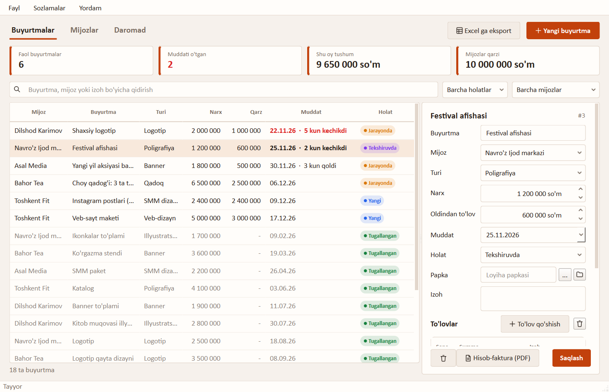

# Mijoz buyurtmalari daftari: Uslubiy ko‘rsatma

Muallif: Hakimov Bahtiyorjon. Versiya: 1.0.2.

## 1. Uslubiy ko‘rsatmaning maqsadi va vazifalari

Ushbu uslubiy ko‘rsatmaning maqsadi “Mijoz buyurtmalari daftari” dasturidan ma’lumotlar bazalari, axborot tizimlari, tadbirkorlik asoslari va dizayn sohasidagi kasbiy faoliyatni tashkil etishga oid fanlarda o‘quv vositasi sifatida foydalanish tartibini belgilashdan iborat. Dastur talabalarga buyurtmalarni hisobga olish jarayonini real predmet sohasi misolida ko‘rsatish, ma’lumotlar o‘rtasidagi bog‘lanishlar va avtomatik hisob-kitoblar mantiqini amalda o‘rgatish imkonini beradi.

Uslubiy ko‘rsatmaning vazifalari:

- dasturning imkoniyatlari va o‘quv jarayonidagi o‘rnini aniqlash;
- 80 daqiqalik amaliy mashg‘ulotning namunaviy rejasini taklif etish;
- dasturning haqiqiy funksiyalariga asoslangan amaliy topshiriqlar va kutilgan natijalarni berish;
- baholash mezonlari va nazorat savollarini shakllantirish;
- shaxsiy ma’lumotlar bilan ishlash madaniyati bo‘yicha qoidalarni eslatish.
Mashg‘ulot natijasida talaba mijoz, buyurtma va to‘lov o‘rtasidagi bog‘lanishni tushuntira oladi, qarz va tushumni hisoblash qoidalarini biladi, dasturda buyurtmalar oqimini yurita oladi, hisobot va hisob-faktura tayyorlaydi hamda ma’lumotlar xavfsizligini ta’minlash choralarini qo‘llaydi.

Ko‘rsatma o‘qituvchiga mashg‘ulotni tayyorlash vaqtini qisqartirish, topshiriqlarni bosqichma-bosqich tashkil etish va talabalar faoliyatini yagona mezonlar asosida baholashda yordam beradi. Ko‘rsatmadagi topshiriqlar guruhning tayyorgarlik darajasiga qarab qisqartirilishi yoki kengaytirilishi mumkin.

## 2. Qo‘llash sohasi va maqsadli auditoriya

Dasturdan quyidagi fanlar va mutaxassisliklarda foydalanish tavsiya etiladi:

- oliy ta’lim muassasalarida “Ma’lumotlar bazasi”, “Axborot tizimlari”, “Tadbirkorlik asoslari”, “Dizayn menejmenti” fanlari;
- kollej va texnikumlarda grafik dizayn, kompyuter texnologiyalari va buxgalteriya yo‘nalishidagi kasbiy fanlar;
- frilans va mustaqil bandlik bo‘yicha qisqa muddatli kurslar va malaka oshirish mashg‘ulotlari;
- tashkilotlarda kichik ijodiy bo‘linmalar, dizayn studiyalari va reklama xizmatlari xodimlarining buyurtmalar hisobini yuritish ishlari.
Maqsadli auditoriya: o‘qituvchilar, talabalar, kollej o‘quvchilari, mustaqil ishlovchi dizaynerlar va kichik studiya rahbarlari. Dastur bilan ishlash uchun kompyuterdan boshlang‘ich foydalanish ko‘nikmalari yetarli; ma’lumotlar bazasi nazariyasi bo‘yicha dastlabki bilimlar mashg‘ulot samaradorligini oshiradi.

Kasbiy faoliyatda dastur dizayner, illyustrator, SMM mutaxassisi yoki veb-dizayner kabi buyurtma asosida ishlovchi mutaxassislarga buyurtmalar oqimini tartibga solish, mijozlar bilan hisob-kitobni nazorat qilish va oylik daromadni tahlil qilishda yordam beradi. Dasturdagi ish turlari ro‘yxati dizayn yo‘nalishiga moslashtirilgan, ammo “Boshqa” turi orqali boshqa xizmatlarni ham qayd etish mumkin.

## 3. O‘quv mashg‘ulotida foydalanish tartibi

Quyida “Buyurtmalar va to‘lovlarni hisobga olish axborot tizimi” mavzusidagi 80 daqiqalik amaliy mashg‘ulot rejasi keltirilgan. Mashg‘ulotdan oldin o‘qituvchi kompyuterlarga dasturni joylashtiradi va har bir talabaga uch mijoz va besh buyurtmadan iborat shartli ma’lumotlar ro‘yxatini tarqatadi. Haqiqiy shaxslarning ma’lumotlaridan foydalanilmaydi.

1. Tashkiliy qism (5 daqiqa): davomatni tekshirish, mashg‘ulot maqsadi va kutilgan natijalarni e’lon qilish.
2. Nazariy qism (20 daqiqa): hisob obyektlari (mijoz, buyurtma, to‘lov) va ular orasidagi “bir-ko‘p” munosabatlar; tashqi kalit va kaskad o‘chirish tushunchasi; qarz, faol holat va muddat o‘tishini hisoblash qoidalari; tushumning oylar bo‘yicha hisobi; sanalarni yil-oy-kun formatida saqlashning afzalligi. O‘qituvchi dastur oynasini proyektorda namoyish qiladi.
3. Amaliy qism (45 daqiqa): talabalar 1–5-topshiriqlarni bajaradi. O‘qituvchi har bir topshiriqdan keyin ko‘rsatkich kartalaridagi qiymatlarni talabalar bilan birga tekshiradi.
4. Yakuniy qism (10 daqiqa): Excel eksport faylini birgalikda ko‘rib chiqish, natijalarni muhokama qilish, uyga vazifa berish.
Nazariy qismda talabalar e’tiborini quyidagi holatlarga qaratish tavsiya etiladi: mijoz o‘chirilganda buyurtmalar nima uchun saqlanadi, buyurtma o‘chirilganda esa to‘lovlar nima uchun o‘chiriladi; bekor qilingan buyurtma qarz va tushum hisobiga nega kirmaydi; oldindan to‘lov qaysi sana bilan tushumga yoziladi. Bu savollar ma’lumotlar yaxlitligi va biznes qoidalarining dasturda qanday ifodalanishini tushunishga yordam beradi.

Amaliy qismni juftlikda tashkil etish mumkin: bir talaba ma’lumotlarni kiritadi, ikkinchisi qarz va tushumni qog‘ozda mustaqil hisoblab, dastur natijasi bilan solishtiradi.

Mashg‘ulotga tayyorgarlik ko‘rishda o‘qituvchi dasturni oldindan o‘zi sinab ko‘rishi, shartli ma’lumotlar ro‘yxatini tuzishi va kutilgan ko‘rsatkichlar qiymatlarini (faol buyurtmalar soni, umumiy qarz, joriy oy tushumi) hisoblab qo‘yishi tavsiya etiladi. Bu amaliy qismda talabalar natijalarini tez tekshirishga imkon beradi. Muddati o‘tgan buyurtma hosil bo‘lishi uchun ro‘yxatda muddati mashg‘ulot kunidan oldingi sanaga belgilangan buyurtma bo‘lishi kerak.

Yakuniy qismda o‘qituvchi talabalar bilan birga quyidagi savollarni muhokama qiladi: qaysi ko‘rsatkich frilanser uchun eng muhim va nima uchun; qo‘lda yuritiladigan jadvalga nisbatan dasturning afzalligi va cheklovlari nimada; ma’lumotlar bazasi fayli yo‘qolsa, qanday oqibatlar bo‘ladi va undan qanday himoyalanish mumkin. Muhokama natijalari uy vazifasini tanlashda hisobga olinadi.

*1-rasm. Mashg‘ulotda namoyish qilinadigan “Buyurtmalar” ko‘rinishi: ko‘rsatkich kartalari, buyurtmalar jadvali va buyurtma paneli*

## 4. Amaliy topshiriqlar

1. **Mijozlar kartotekasini yaratish.** Tarqatilgan ro‘yxat bo‘yicha uch mijozni ism, telefon, Telegram va izoh bilan kiriting. Kutilgan natija: “Mijozlar” jadvalida uchta yozuv, Telegram manzillari “@” bilan boshlanadi.
2. **Buyurtmalarni kiritish.** Har xil ish turi, narx, oldindan to‘lov va muddatga ega beshta buyurtma yarating, ulardan birining muddati o‘tgan bo‘lsin. Kutilgan natija: “Faol buyurtmalar” kartasida 5, “Muddati o‘tgan” kartasida 1, tegishli qator qizil rangda.
3. **To‘lovlar va qarz.** Ikki buyurtmaga qisman, bittasiga to‘liq to‘lov kiriting. Kutilgan natija: “Qarz” ustuni va “Mijozlar qarzi” kartasi qo‘lda hisoblangan qiymatlarga mos keladi.
4. **Holatlar bilan ishlash.** Bitta buyurtmani “Tugallangan”, bittasini “Bekor qilingan” holatiga o‘tkazing. Kutilgan natija: faol buyurtmalar soni kamayadi, bekor qilingan buyurtmaning qarzi nolga teng bo‘ladi, tushum qayta hisoblanadi.
5. **Qidiruv va filtrlar.** Buyurtmalarni mijoz, holat va kalit so‘z bo‘yicha filtrlang, “Muddati o‘tgan” kartasidan foydalaning. Kutilgan natija: har bir filtr natijasi bo‘yicha qisqa yozma izoh.
6. **Hisob-faktura.** Qisman to‘langan buyurtma uchun dizayner ismini o‘zgartirib, PDF hisob-faktura tayyorlang. Kutilgan natija: PDF faylda to‘lovlar jadvali va “To‘lanishi kerak” qoldiq summasi to‘g‘ri ko‘rsatilgan.
7. **Excel hisobot va tahlil.** Ma’lumotlarni Excel ga eksport qiling va oylik tushum varag‘i asosida “Daromad” ko‘rinishidagi grafik bilan solishtiring. Kutilgan natija: to‘rt varaqli xlsx fayl va qiymatlar mosligi haqida xulosa.
8. **Ma’lumotlar yaxlitligini tekshirish.** Bitta mijozni o‘chiring, so‘ng to‘lovli buyurtmani o‘chiring. Kutilgan natija: mijozning buyurtmalari saqlanib, “Mijoz” ustunida “(mijozsiz)” deb ko‘rsatiladi, o‘chirilgan buyurtmaning to‘lovlari tushumdan chiqadi; talaba buni tashqi kalit qoidalari bilan izohlaydi.
Topshiriqlar bajarilgach, talaba qisqa hisobot tayyorlaydi. Hisobotda kiritilgan ma’lumotlar, har bir topshiriqdan keyingi ko‘rsatkich kartalari qiymatlari, qo‘lda bajarilgan hisob-kitoblar va ularning dastur natijasi bilan solishtirilishi, aniqlangan farqlar va ularning sabablari yoziladi. 1–5-topshiriqlar mashg‘ulot vaqtida, 6–8-topshiriqlar mashg‘ulot oxirida yoki uy vazifasi sifatida bajariladi. Tayyorgarligi yuqori guruhlarda o‘qituvchi qo‘shimcha topshiriq sifatida Excel fayli asosida qarzdorlik bo‘yicha mijozlar reytingini tuzishni berishi mumkin.

## 5. Baholash mezonlari

Amaliy ish 100 ball bilan baholanadi:

- mijoz, buyurtma va to‘lovlarning to‘liq va to‘g‘ri kiritilishi – 25 ball;
- qarz, tushum va muddat bo‘yicha hisob-kitoblarni mustaqil tekshirish va dastur natijasi bilan solishtirish – 25 ball;
- hisob-faktura va Excel hisobotning to‘g‘ri tayyorlanishi – 20 ball;
- ma’lumotlar yaxlitligi qoidalarini tushuntirish (8-topshiriq) – 15 ball;
- nazorat savollariga javob va muhokamadagi ishtirok – 15 ball.
Baholash shkalasi: 86–100 ball “a’lo”, 71–85 ball “yaxshi”, 55–70 ball “qoniqarli”, 55 balldan kam “qoniqarsiz”. Hisob-kitoblarda xatoga yo‘l qo‘yilgan, lekin talaba uning sababini to‘g‘ri aniqlagan holatda ball qisman saqlanadi.

Baholashda talabaning dasturdan foydalanish ko‘nikmasi bilan bir qatorda hisob-kitob mantiqini tushunishi ham hisobga olinadi. Masalan, qarz qiymati dastur ko‘rsatgani bilan mos kelgan, ammo talaba uni qanday hisoblanganini tushuntira olmagan holatda ikkinchi mezon bo‘yicha ball kamaytiriladi. Hisob-faktura va Excel fayllari elektron ko‘rinishda, talaba familiyasi yozilgan papkada topshiriladi.

## 6. Nazorat savollari

1. Dastur qaysi uchta asosiy hisob obyekti bilan ishlaydi va ular o‘zaro qanday bog‘langan?
2. Buyurtma bo‘yicha to‘langan summa va qarz qanday hisoblanadi?
3. Qaysi holatlar faol hisoblanadi va buyurtma qachon muddati o‘tgan deb belgilanadi?
4. Mijoz o‘chirilganda uning buyurtmalari bilan nima sodir bo‘ladi va nima uchun?
5. Buyurtma o‘chirilganda uning to‘lovlari bilan nima sodir bo‘ladi?
6. “Shu oy tushum” ko‘rsatkichiga qaysi summalar kiradi?
7. Bekor qilingan buyurtmalar hisob-kitoblarda qanday hisobga olinadi?
8. Excel eksport fayli qaysi varaqlardan iborat?
9. Ma’lumotlar bazasi fayli qayerda saqlanadi va undan qanday zaxira nusxa olinadi?
10. Baza fayli buzilganda dastur qanday harakat qiladi?
Savollar og‘zaki so‘rov, yozma test yoki mustaqil ish himoyasida qo‘llanilishi mumkin. 2, 4, 5 va 7-savollarga javob berishda talaba dasturda bajargan amaliy topshiriqlaridan misol keltirishi tavsiya etiladi.

Javoblarni baholashda talabaning dastur interfeysidagi nomlarni to‘g‘ri atashi va hisob-kitob qoidalarini o‘z so‘zlari bilan tushuntira olishi hisobga olinadi.

## 7. Mustaqil ish uchun tavsiyalar

- Bir oy davomida shartli (yoki o‘z o‘quv loyihalaringiz bo‘yicha) buyurtmalar oqimini dasturda yuriting va oy oxirida “Daromad” ko‘rinishi asosida qisqa tahliliy hisobot tayyorlang.
- Dastur ma’lumotlar modeliga mos ER-diagramma chizing: jadvallar, maydonlar, birlamchi va tashqi kalitlarni ko‘rsating.
- SQLite hujjatlarini o‘rganib, tashqi kalitlardagi “SET NULL” va “CASCADE” qoidalarining farqi haqida referat yozing.
- Excel eksport faylidagi ma’lumotlar asosida elektron jadvalda ish turlari bo‘yicha qo‘shimcha diagramma tuzing va uni dastur jadvali bilan solishtiring.
- Dastur ishlatadigan hisob-kitob qoidalarini (qarz, faol holat, muddat o‘tishi, tushum) psevdokod yoki blok-sxema ko‘rinishida tavsiflang va ularni SQL so‘rovlari ko‘rinishida yozishga harakat qiling.
- Frilanser faoliyatida qanday qo‘shimcha ma’lumotlar (masalan, tuzatishlar soni yoki ish soatlari) foydali bo‘lishini tahlil qilib, ma’lumotlar modelini kengaytirish bo‘yicha taklif tayyorlang.
Mustaqil ish natijalari keyingi mashg‘ulotda qisqa taqdimot shaklida himoya qilinadi.

Mustaqil ish uchun materiallar tanlashda talabaning kelgusi mutaxassisligini hisobga olish tavsiya etiladi: dizayn yo‘nalishi talabalari asosan buyurtmalar oqimi va hisob-fakturaga, axborot texnologiyalari yo‘nalishi talabalari esa ma’lumotlar modeli va hisob-kitob qoidalariga e’tibor qaratadi. Himoya jarayonida talaba o‘z ishining amaliy qo‘llanish sohasini asoslab berishi kerak.

## 8. Xavfsizlik va axborot madaniyati qoidalari

- O‘quv mashg‘ulotlarida haqiqiy mijozlarning telefon raqamlari va boshqa shaxsiy ma’lumotlaridan foydalanmang, faqat shartli ma’lumotlarni kiriting.
- Kasbiy faoliyatda mijozlarning shaxsiy ma’lumotlarini uchinchi shaxslarga bermang; Excel eksport fayllari va hisob-fakturalarni xavfsiz joyda saqlang.
- Baza faylidan muntazam zaxira nusxa oling va uni alohida qurilmada saqlang.
- Umumiy kompyuterlarda ishlaganda boshqa foydalanuvchining baza faylini ochmang va o‘zgartirmang, ishni tugatgach shaxsiy fayllarni o‘chiring.
- Dasturni faqat muallifning rasmiy GitHub sahifasidan yuklab oling.
- Uzoq vaqt kompyuterda ishlaganda har 45–50 daqiqada qisqa tanaffus qiling.
- Hisob-faktura va Excel hisobotlarni mijozga yuborishdan oldin ulardagi ma’lumotlar to‘g‘riligini tekshiring; noto‘g‘ri summa ko‘rsatilgan hujjat mijoz bilan munosabatlarga salbiy ta’sir qilishi mumkin.
- Dastur hisob-fakturasi soliq hisobi uchun rasmiy hujjat emasligini talabalarga tushuntiring; rasmiy hisobot talab etilganda amaldagi qonunchilikda belgilangan shakllardan foydalaniladi.
